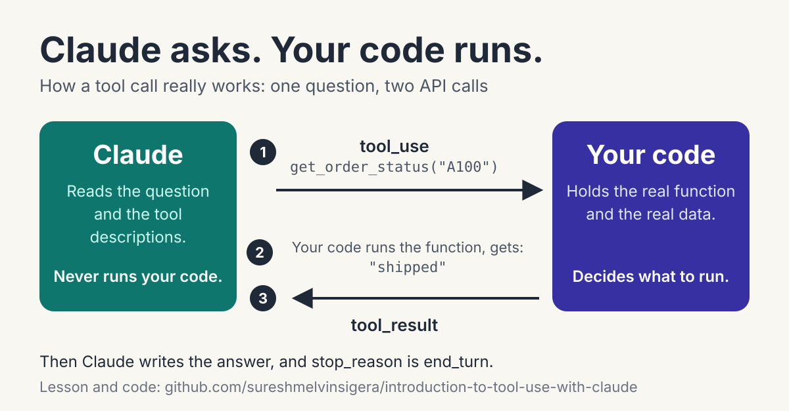

# Introduction to Tool Use with Claude



#### Learning Objectives

- Explain why Claude cannot look at your database or call your API by itself, and what a tool changes about that.
- Write a tool definition with a name, a description, and an input schema.
- Recognize a `tool_use` block in a response and say who runs the function it names.
- Return a `tool_result` with the matching `tool_use_id` so Claude can finish its answer.
- Read `stop_reason` to tell whether Claude is asking for a tool or has finished.

#### Introduction

Ask Claude where order A100 is and it has no way to know. Your orders live in your database, behind your login, on your
servers. Claude can write a perfectly fluent paragraph about shipping delays, and that is the danger: without a way to
look, a fluent answer and a correct answer are two different things.

Tools are the fix, but not in the way most people first picture. Claude never reaches into your system. It sends a
structured request, and some code on your side decides whether to answer it. Who does what in that exchange is the whole
unit, and getting it backwards is the most common mistake in the first week.

#### The Function Stays on Your Side

The function that answers the question is deliberately boring. It takes an order ID and returns a status from a
dictionary, standing in for the database you would really query.

```python
ORDERS = {"A100": "shipped", "A200": "processing"}


def get_order_status(order_id: str) -> str:
    return ORDERS.get(order_id, "not found")
```

Claude will never see this code. It does not know the dictionary exists, and it cannot call the function. Everything
Claude learns about this capability comes from a description you write, which is the next half of the same file,
`order_tools.py`.

#### The Description Is All Claude Gets

A tool definition has three parts. The name identifies it, the description says what it does and when to use it, and the
input schema says what arguments it takes. Claude reads these the way a new colleague reads a job card pinned above a
station.

```python
TOOLS = [
    {
        "name": "get_order_status",
        "description": "Look up the current status of a customer order by its order ID.",
        "input_schema": {
            "type": "object",
            "properties": {
                "order_id": {"type": "string", "description": "The order ID, for example A100"},
            },
            "required": ["order_id"],
        },
    }
]
```

The description carries more weight than it looks. When an application has several tools, Claude picks between them by
reading these sentences, so two vague descriptions that sound alike are a reliable way to get the wrong tool called. A
good description answers two questions: what does this do, and when should it be used.

The definition tells Claude the tool exists. It does not run anything, so the next question is what happens when Claude
actually wants it.

#### One Question, Two Requests

A single user question can take two calls to the API. The first call sends the question along with the tool definitions,
and Claude answers with a request instead of text. Your code runs the function and sends the output back in a second
call, and only then does Claude write the final answer.

The file `order_status_demo.py` does exactly that. It collects every `tool_use` block from the first response, runs the
matching function for each one, and builds a `tool_result` for each.

```python
import sys

import anthropic

from order_tools import TOOLS, get_order_status

MODEL = "claude-sonnet-5-5"


def text_of(response) -> str:
    return "".join(block.text for block in response.content if block.type == "text")


def ask_about_order(question: str, client=None) -> dict:
    client = client or anthropic.Anthropic()
    messages = [{"role": "user", "content": question}]

    first = client.messages.create(
        model=MODEL, max_tokens=1000, tools=TOOLS, messages=messages
    )

    requests = [block for block in first.content if block.type == "tool_use"]
    if not requests:
        return {
            "first_stop_reason": first.stop_reason,
            "requests": [],
            "second_stop_reason": None,
            "answer": text_of(first),
        }

    results = [
        {
            "type": "tool_result",
            "tool_use_id": request.id,
            "content": get_order_status(**request.input),
        }
        for request in requests
    ]

    messages.append({"role": "assistant", "content": first.content})
    messages.append({"role": "user", "content": results})

    second = client.messages.create(
        model=MODEL, max_tokens=1000, tools=TOOLS, messages=messages
    )

    return {
        "first_stop_reason": first.stop_reason,
        "requests": [{"name": r.name, "input": r.input} for r in requests],
        "second_stop_reason": second.stop_reason,
        "answer": text_of(second),
    }


if __name__ == "__main__":
    question = " ".join(sys.argv[1:]) or "Where is order A100?"
    result = ask_about_order(question)

    print("First stop_reason:", result["first_stop_reason"])
    for request in result["requests"]:
        print("Claude asked for:", request["name"], request["input"])
    print("Second stop_reason:", result["second_stop_reason"])
    print("Answer:", result["answer"])
```

Install the `anthropic` package, set `ANTHROPIC_API_KEY`, and run it from the repository root. The prints are there
so you can watch the two calls happen instead of taking the result on faith.

Pay attention to where `get_order_status` is called. It is called by your code, after the first response has come back,
using the arguments Claude supplied in `request.input`. The model asked; your program ran the function.

#### Matching Answers to Requests

Every `tool_use` block carries an `id`, and the `tool_result` you send back must repeat it as `tool_use_id`. That is how
the API knows which request you are answering. If Claude asks for two things in one response, you answer both in the
same user message, each with its own id.

The order of the two `append` calls matters too. Claude's own response goes into the history first, because the request
has to be on the record before an answer to it makes sense. Leave it out and the API rejects the next call, since a
`tool_result` would point at a request that was never made.

That leaves the question of how the code knew to run the function at all. It checked for `tool_use` blocks, but the
response also tells you directly.

#### Reading stop_reason

When Claude wants a tool, the `stop_reason` of that response is `tool_use`. When Claude has finished its answer, it is
`end_turn`. The demo prints both, so on a normal run you see `tool_use` after the first call and `end_turn` after the
second.

This value is the signal a real program branches on. It is Claude explaining why it stopped, not an error and not a
limit you set yourself. The unit on the agent loop builds on it, because a loop is simply this exchange repeated until
the value says `end_turn`.

One more case is worth seeing before moving on, because it shows that the tool is optional.

#### When Claude Does Not Need the Tool

Having a tool available does not mean Claude uses it. A question about the capital of France has nothing to do with
orders, so Claude answers directly. The second demo reuses the same function with that question.

```python
from order_status_demo import ask_about_order

result = ask_about_order("What is the capital of France?")

print("First stop_reason:", result["first_stop_reason"])
print("Tool requests:", len(result["requests"]))
print("Answer:", result["answer"])
```

Run it and compare the first `stop_reason` with the one from the order demo. The decision to ask for a tool belongs to
Claude, and it makes that decision from the description alone. Try changing the description in `order_tools.py` to
something vague and ask about an order again.

#### Summary

- Claude cannot reach your systems. A tool is a description you give it, so it can ask for something to be done. Your
  code decides whether and how to do it.
- A tool definition has a name, a description, and an input schema. Claude chooses tools by reading the description, so
  it should say what the tool does and when to use it.
- A response with `stop_reason` equal to `tool_use` contains `tool_use` blocks. Your code runs the function and sends
  back a `tool_result` whose `tool_use_id` matches the request.
- Claude's response goes into `messages` before the results. The API rejects a `tool_result` that answers a request
  missing from the history.
- A response with `stop_reason` equal to `end_turn` means Claude is finished. Whether it asks for a tool at all is
  Claude's decision, based on the question and the descriptions.

---

#### Running the code

```bash
uv sync                            # or: pip install anthropic
export ANTHROPIC_API_KEY=...       # fish: set -x ANTHROPIC_API_KEY ...

uv run python order_status_demo.py
uv run python order_status_demo.py "What is the status of order Z999?"
uv run python no_tool_needed_demo.py
```